# Dev diary

How *Echoes Among the Stars* got from an idea to where it is now: every version, rewrite and dead end that's left a trace.

**Who does what.** Sam comes up with the story, the characters and the design, makes every decision, and generates the art and video with AI tools. Claude does most of the hands-on work: it writes all the code, drafts the documents and spreadsheets from Sam's direction, proposes systems, and drafts prose in Sam's voice for him to revise. Sam's own voice spec puts it this way: *"I do the architecture… The drafting does the sentences."*

Dates come from the files themselves and from the project's Claude chats. Where a date is a best guess, the entry says so.

[Jump to the latest entry ↓](#4-october-2026--moving-into-github-and-a-scare)

---

## By the numbers

| | |
|---|---|
| Versions of the opening scenes before the current game | 7 or more |
| Game engines | 4 prototypes → engine v1 → engine v2 |
| Clues in the case | 4 → 9 → 24 → 36 |
| Character sheets | 3 → 11 (one since lost) |
| Playable scenes today | 20 (Day 0 and Day 1), about 3,000 words of in-game text |
| Voice spec | version 0.6 |
| Shaw interview scene | revision 3 |
| Announce trailer | video v1 → rebuild plan v2 → keyframe plan v3 |

---

## 6 December (probably 2024) — Version 7 of the opening

The earliest file that survives is called *Space Murder game 6 Dec_v7*. The "v7" means at least six earlier attempts at the opening came before it. It was a playable web page: Amelia arrives, meets the Captain, reads her emails (one from Lawson, and one from her parents that opens "Hey Rocket Girl!"), and two meters track Crew Reputation and Captain's Trust.

The year isn't in the file. It's very likely December 2024, since the design document from February 2025 already describes a reworked story.

*This file was damaged in October 2026 and no longer runs. It's kept in `prototypes/damaged/` for the record.*

## 2 February 2025 — The game design document

The game gets its name, *Echoes Among the Stars*, and a full design document. This wasn't a first draft of the story either: the document talks about a "revised plot" and "revised chronology". This is the version where Captain Lawson becomes the hidden manipulator, and where Shaw's fiancée Isabelle "Izzy" Cole is added as a new character, along with the two endings (accuse Shaw, or expose Lawson).

📄 [`design/ECHOES AMONG THE STARS-Game Design Document 2 Feb 2025.docx`](../design/)

## 2025 (dates uncertain) — Trying out game systems

Several small prototypes tested how the investigation could actually play, alongside a scene-by-scene tracker of the story (121 rows).

- **Systems slice:** one screen with a station map (5 locations), 3 actions a day, a suspicion meter for 3 suspects, 4 clues and an end-of-day report.
- **VN systems build:** a visual-novel layout with a ship map, evidence board and daily report.
- **Day 0 + systems:** an attempt to join the story opening and the systems into one build. *(Damaged in October 2026; kept for the record.)*

A 128 MB screen recording of the demo is dated **9 August 2025**. It's too big for GitHub, so it stays on Sam's computer.

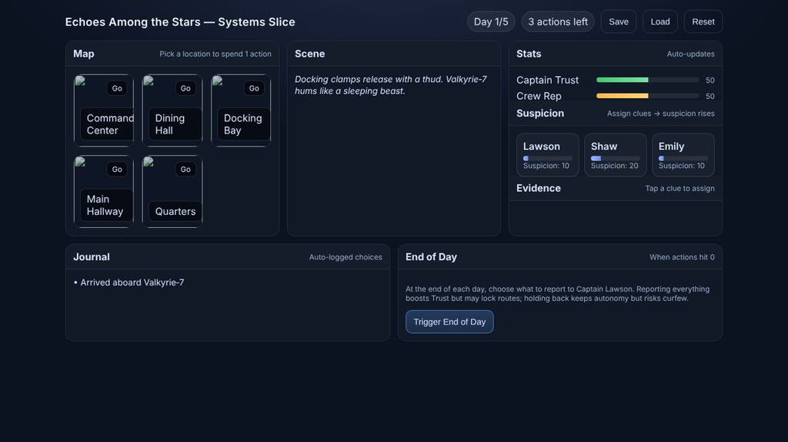
*The systems slice: everything on one screen.*

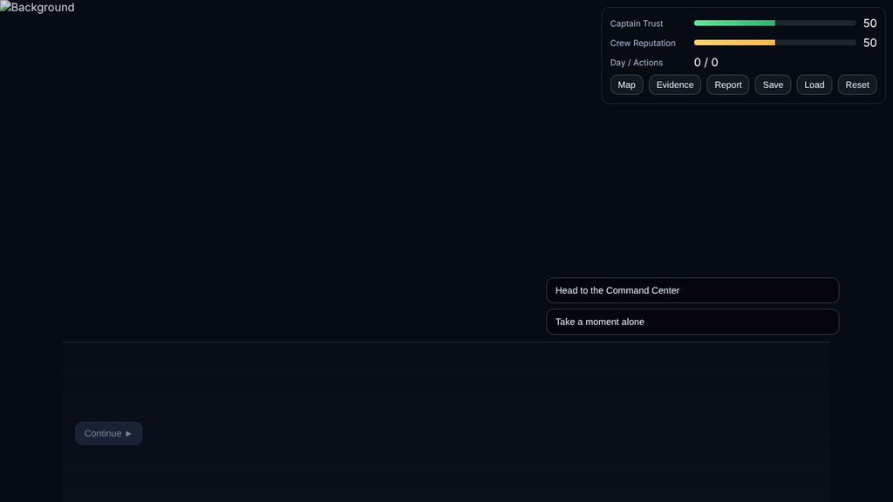
*The VN systems build, with no art loaded.*

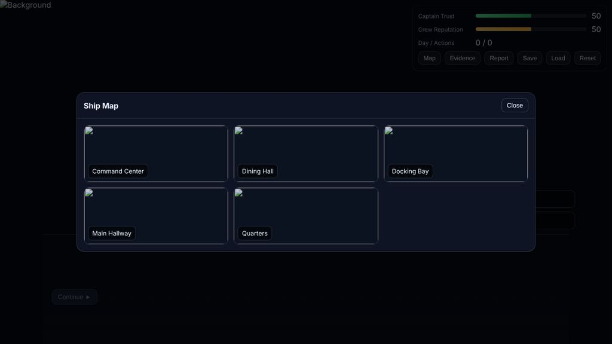
*Its ship map: 5 locations.*

## 15 March 2026 — Taking stock, and engine v1

Sam brought everything to Claude and asked for a full review and a plan, saying: "There is only myself and I have no game design experience, so I will be reliant on you for everything."

The review was blunt:
- There were two prototypes doing different halves of the job, and they needed merging.
- All the story was typed straight into the code, which wouldn't scale to six days of scenes.
- Day 0 stopped partway through the dinner.
- Only 3 of the 11 characters had sheets.
- The investigation systems were mostly placeholders: 5 locations, 4 clues, and suspect meters that didn't move.

The same day:
- **Engine v1**, which split the game into two files: the engine (`index.html`) and all the story content (`game_data.js`), so the story can grow without touching the code.
- **Day 0 written through to the murder**: arrival, the Captain, settling in, Max in the hallway, the full crew dinner, the evening and the alarm.
- **Technical Design Guide**: how the engine works, how to write scenes, the art checklist.
- **Clue System v1**: 24 clues across four layers (surface, doubt, conspiracy, redemption).
- Two interactive design pages: the clue dependency chain, and the red herrings.

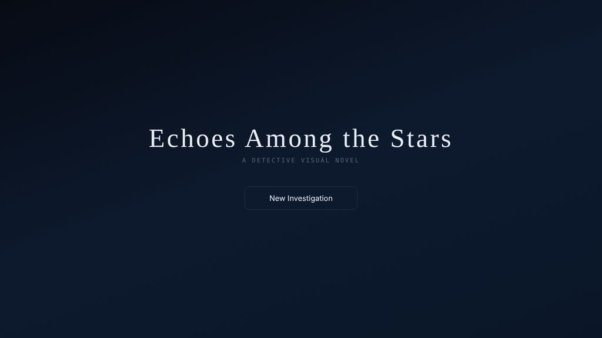
*The title screen.*

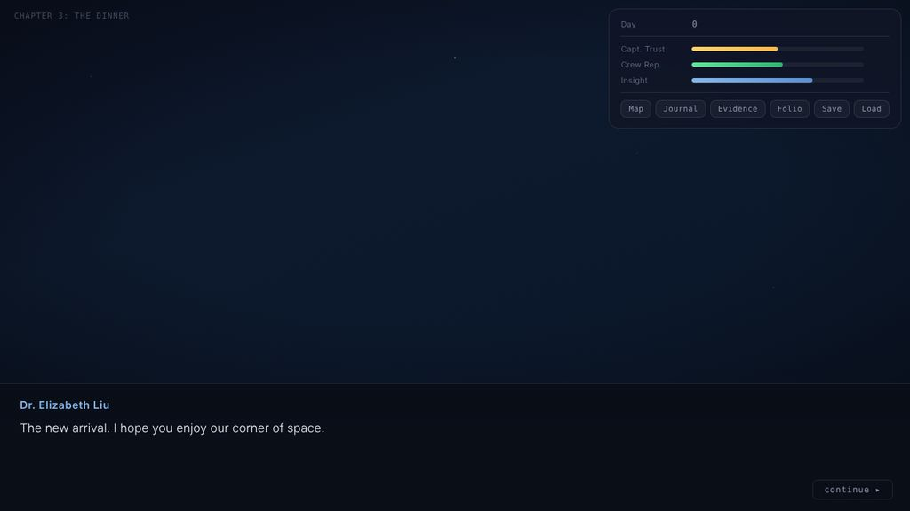
*Day 0: the crew dinner. All the art was lost in October 2026, so for now the game shows a starfield.*

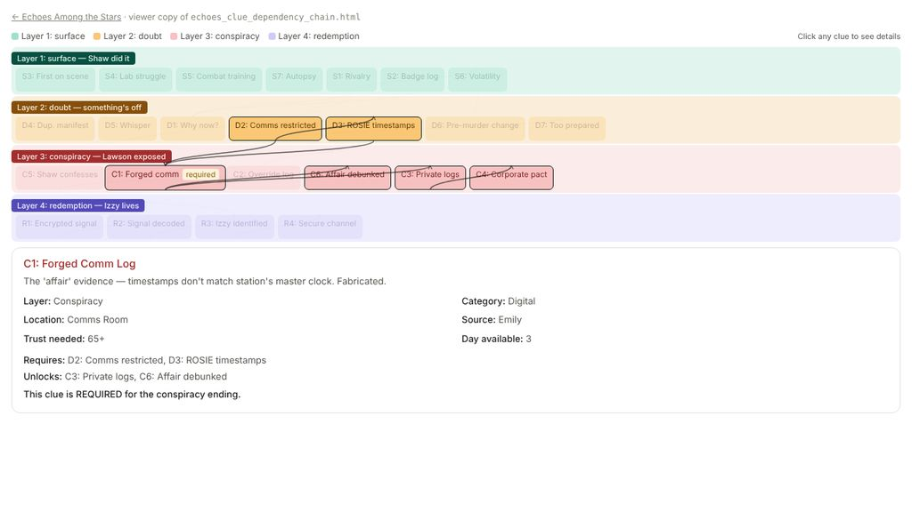
*The clue dependency chain. Tap a clue to see what it needs and what it unlocks.*

## 16 March 2026 — Clue System v2

The clue map grew from 24 to 36 clues, and the idea of **clues as currency**, first sketched on the red herrings page the day before, became part of the design. Each evening the player chooses what to tell Lawson. They can trade a clue for access, or use one to clear an innocent suspect. A new "Information Economy" tab sets out how each of these works.

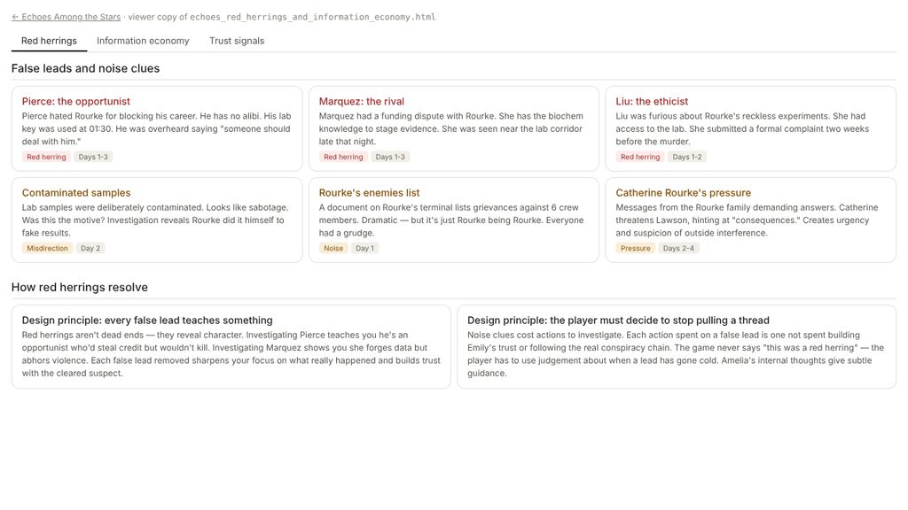
*The red herrings page. Every false lead has to teach the player something.*

## 20 March 2026 — Engine v2: it becomes an investigation game

The biggest single update. Day 0 stays a guided story; from Day 1 the game opens up.

- A station map with 9 locations, and 3 actions a day.
- Events at each location that depend on the day, trust levels and clues already found.
- The daily report to Lawson, where you choose what to share.
- An evidence board, and Amelia's smart-folio, which describes trust in words ("the wall has cracks") instead of numbers.
- Dialogue options that only appear if you hold the right clue.
- **Day 1 written**: the morning briefing and nine location scenes (12 scenes in all).

This was documented in the Systems Update v2, plus a set of project notes so any future Claude chat could pick the project up cold. Those notes grew into today's `CLAUDE.md`.

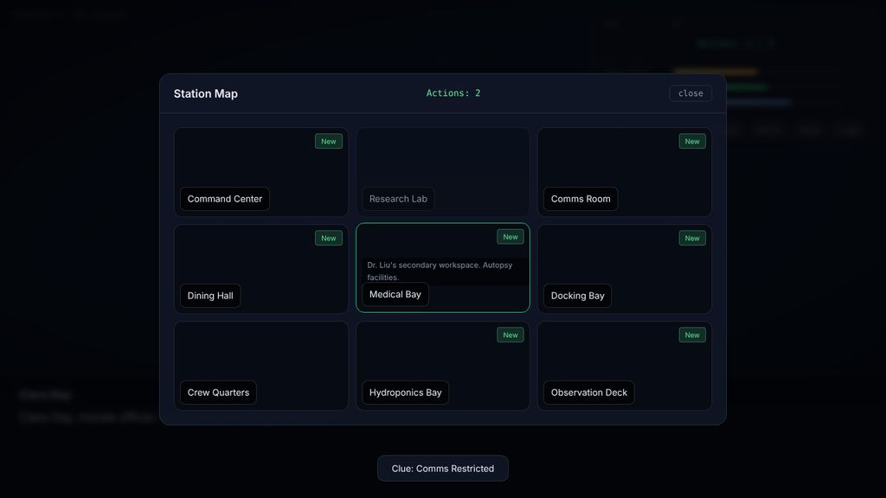
*The station map. "New" marks a location with something to find.*

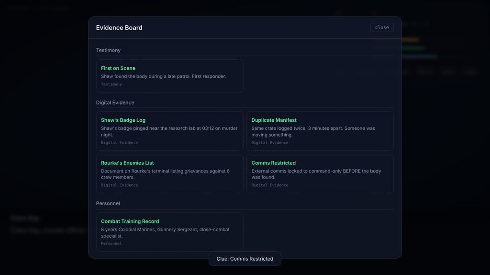
*The evidence board, grouped by type.*

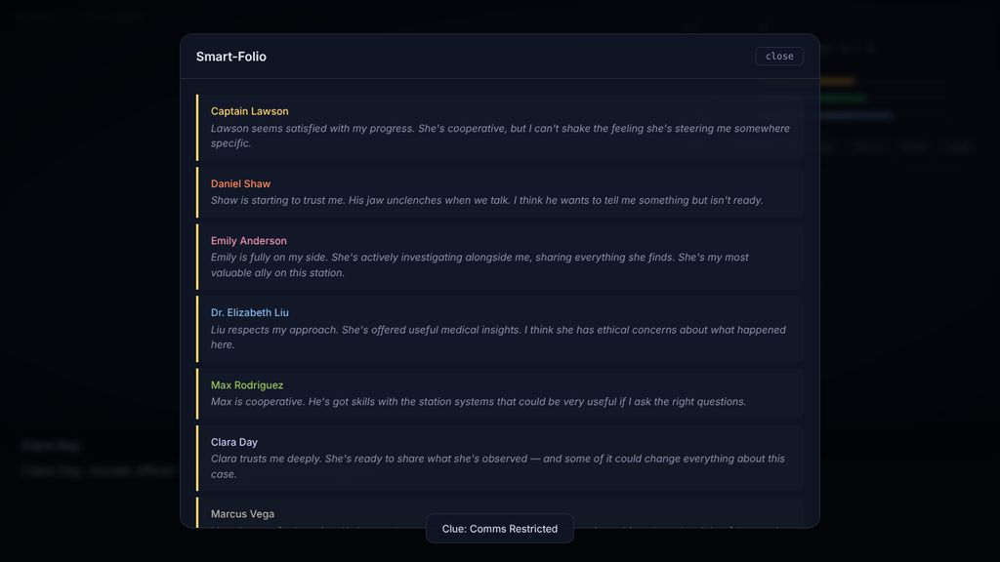
*The smart-folio: trust shown through Amelia's read of each person.*

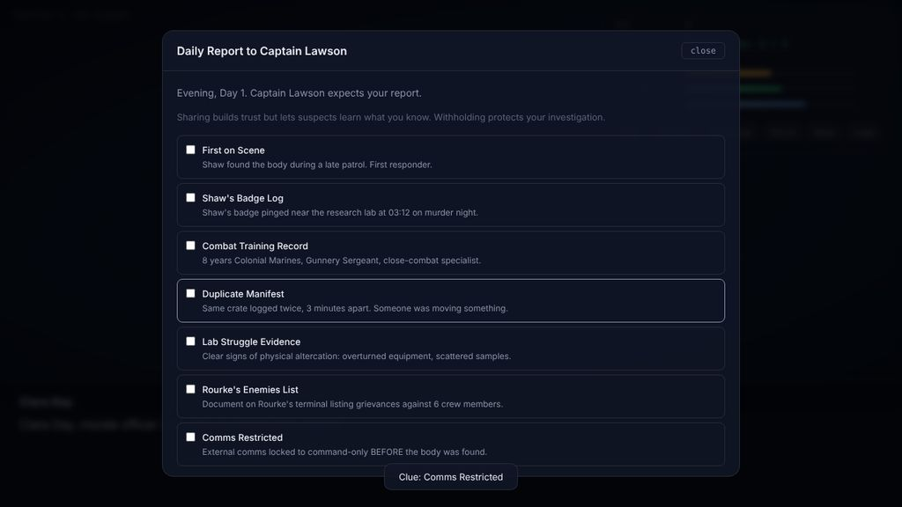
*The daily report: share everything and Lawson trusts you more, but the suspects find out what you know.*

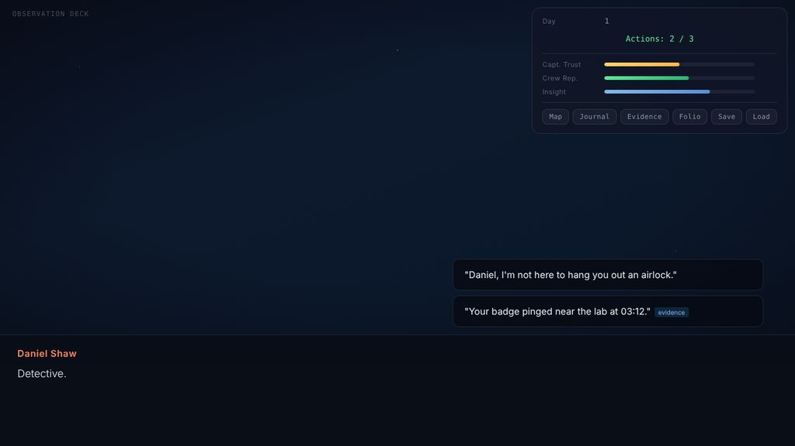
*Day 1: Shaw on the observation deck. The second option only appears because the player has his badge log.*

## 21 March 2026 — The whole crew

All the character sheets were updated, or written from scratch, to match the clue map. Each one sets out who knows what, what it takes to earn their trust, and how they react. That brought the total to 11 sheets. *(Dr Simone Marquez's sheet has since been lost to the file damage.)*

Two more documents came out of the same session: a **Trust Quest Compendium** (a quest for every character, such as Max's coffee machine or Emily's Earth spices) and a **Game Balancing Overview**. The balancing pass found that the path to Emily's highest trust level had no room for a single mistake, and suggested adding a buffer on Day 3.

*Neither of those two documents was on Sam's computer when the repo was set up, so they're not in here yet.*

## 19 July 2026 — Finding the voice

The writing gets its own rulebook: a **voice spec**, now at version 0.6, describing how Sam writes, "in something close to the voice itself". Each rule is tagged by how sure Sam is of it: firm, inferred or hunch. It came with two prose scenes written in that voice and revised several times:

- *Security*: Amelia interviews Shaw (revision 3)
- *Personal Logs*: Amelia reads Shaw's private logs, with R.O.S.I.E. (revision 2)

📄 [`design/authorial-voice-spec-v0.6.md`](../design/authorial-voice-spec-v0.6.md) · [`writing/scenes/`](../writing/scenes/)

## August 2026 — The announce trailer, version 1

Work starts on a 30–45 second announce trailer, built around one "hero shot": Amelia's badge floats in zero gravity, her hand catches it and clips it to her chest, and gravity comes back on. Her face is never shown. Cuts to the crew interrupt it.

Sam corrected the first script: no LED light on the badge (its shine should come from reflections), and Amelia's suit is navy with silver piping, not teal and gold.

The first video (made with Seedance 2.5, 21 seconds) had three problems: the badge changed shape as it turned, Amelia's body faded in instead of the camera moving to reveal her, and the lights faded up instead of switching on. All three came from one cause. The shot opened on pure black, so the video model had nothing fixed to track movement or light against. The rebuild plan (v2) lights the room very dimly from the first frame, and uses the best moment from v1 (8.6 seconds in) as the reference for the badge.

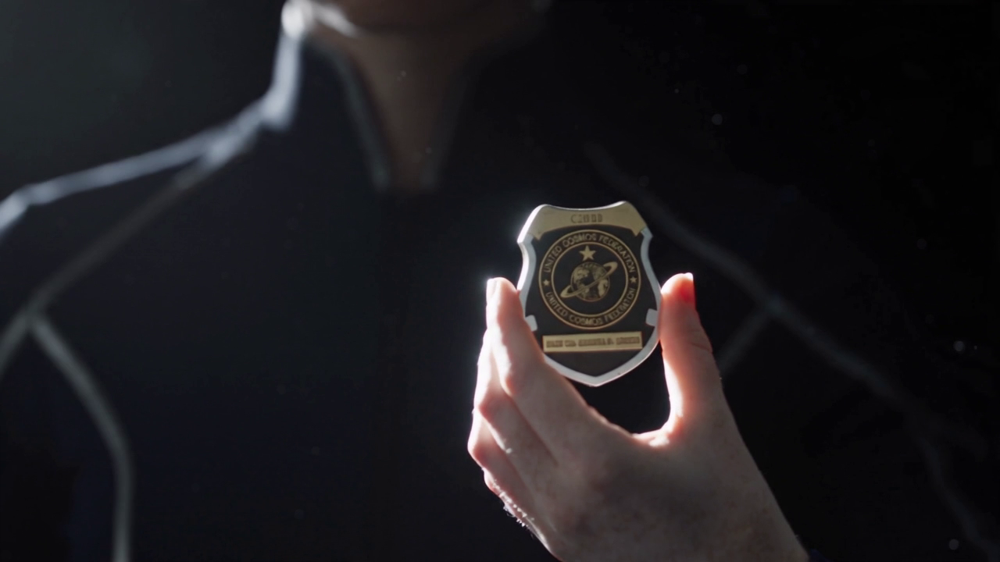
*The frame from 8.6 seconds in that became the badge reference.*

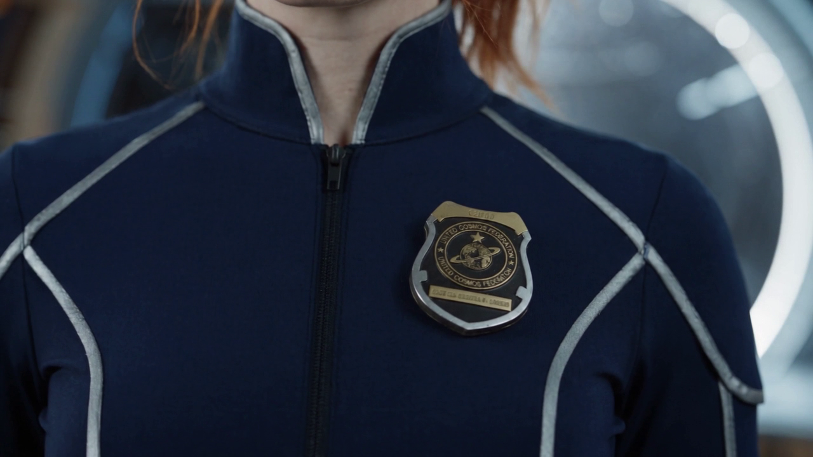
*The badge clipped on, with the lights up.*

📄 [`trailer/`](../trailer/)

## Early October 2026 — Trailer plan v3

New video and voice tools came out (Kling 4.0, and ElevenLabs' Eleven v4). The plan was revised to try the hero shot as a single generation guided by up to 10 keyframes, instead of five clips joined together, and to record the voiceover first so its timing can guide the keyframes.

*This is a plan for now. Some features of these tools were due later in October 2026.*

## 4 October 2026 — Moving into GitHub, and a scare

The whole project moved into this GitHub repo, with a website so it can be played and browsed from a phone.

Setting it up turned up two bigger problems:

- **Damaged files.** Many files in Sam's project folder had parts overwritten at the disk level. Nearly everything was recovered: the game, the design documents and all but one of the character sheets. Some were rebuilt from copies kept in the Claude Project. Two early prototypes couldn't be saved. The full details are in the repair log in [`CLAUDE.md`](../CLAUDE.md).
- **Lost art.** The folder of portraits and backgrounds didn't survive, so the game currently runs with its built-in starfield. *(Leonardo AI keeps a history of past generations, so the originals may still be there.)*

An automated playthrough of the rebuilt game also found two bugs that had been there since March. Day 1 never started properly, so none of its location scenes could ever be reached. And skipping text on the investigation screen made the choice buttons vanish. Both are fixed: the game now plays from the arrival all the way through to Day 2.

---

*New entries are added at the bottom after each working session.*
